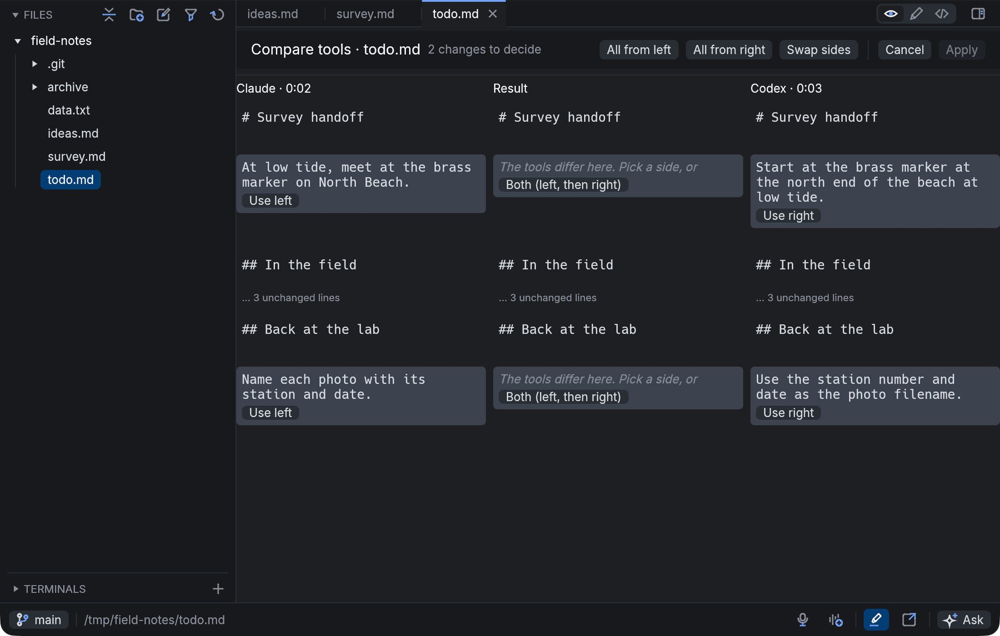
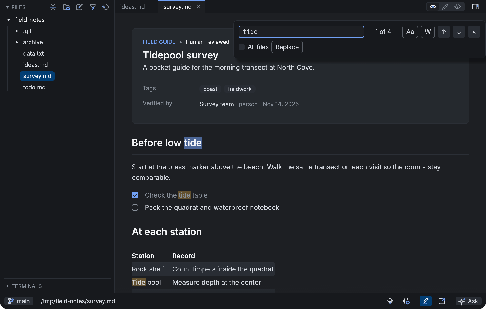
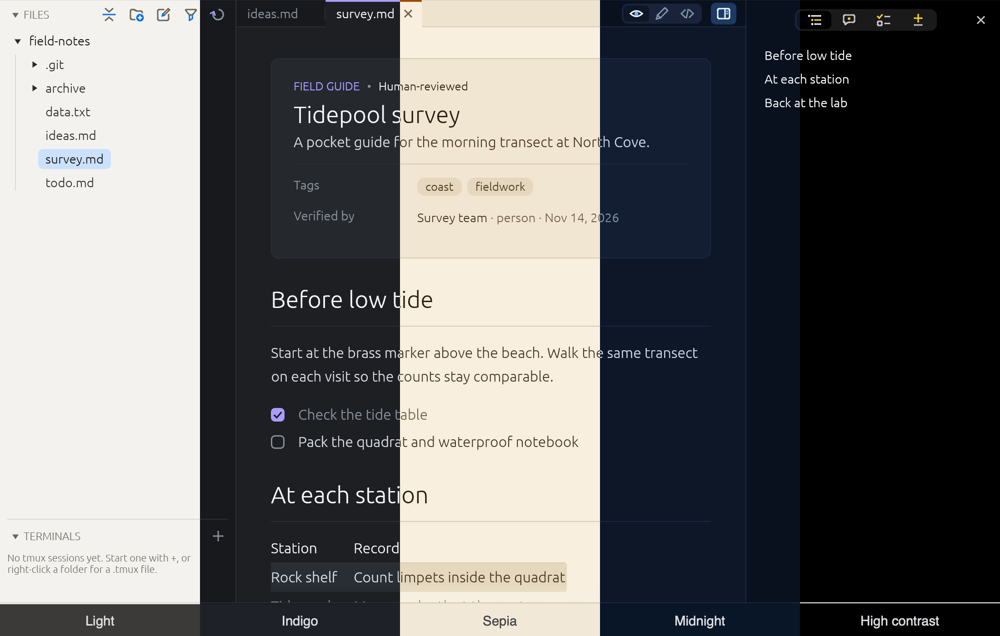

#  Rubrique

A fast editor, agentic on demand. [rubrique.dev](https://rubrique.dev)

Write in a small native editor for macOS and Linux. When you want help
with a passage, press `Cmd/Ctrl+K`. Ask one agent for an edit, or compare
two agents' suggestions side by side and choose what to keep.



## Install

Download a package from the [latest release](https://github.com/witseko/rubrique/releases/latest).

| Install on | How |
| --- | --- |
| macOS (Apple Silicon or Intel) | Open the signed and notarized `.dmg` and drag Rubrique to Applications |
| Debian or Ubuntu (amd64) | `sudo apt install ./rubrique_X.Y.Z-1_amd64.deb` |
| Other Linux (x86_64) | Unpack the `.tar.gz` and run `./install.sh` |

Replace `X.Y.Z` with the version you downloaded. To build from crates.io,
run `cargo install rubrique` with Rust 1.95 or later. On Linux, install
the libraries listed under [Build](#build) first.

## Features

### Reading and writing

- **Markdown.** In Read mode, select text or follow a local Markdown link
  to another tab. Switch to Edit to change a paragraph or table cell in
  place, or to add and remove rows and columns. Source opens the Markdown
  itself. The preview renders footnotes, badges and collapsible sections.
- **Knowledge bases.** YAML front matter appears as a card above the text.
  In an Open Knowledge Format bundle, it shows each concept's status,
  trust tier, freshness and sources. Links that start with `/` open from
  the bundle root. [Open Knowledge Format](https://github.com/GoogleCloudPlatform/open-knowledge-format)
- **HTML.** The built-in preview shows formatted text and collapsible
  sections. For CSS layouts, web fonts and images, turn on Settings >
  Files > HTML preview. Rubrique uses Chrome, Chromium, Edge or Brave,
  or offers to install headless Chrome. Page scripts stay off.
- **reStructuredText.** Open a `.rst` file in Read to see headings,
  tables, footnotes, code blocks, figures and admonitions such as
  `.. note::`. Switch to Source to edit it.
- **PDF and Word.** Open a PDF to browse its pages, or a DOC or DOCX to
  read its text. On Linux, install `antiword` for legacy DOC previews.
- **PowerPoint, OpenDocument Text and Rich Text.** Browse the text from
  each PPTX slide or read the body text of ODT and RTF documents.
  Use **Open in default app** to see the full layout or edit the file.
- **Spreadsheets.** Browse XLS, XLSX and ODS sheets in a read-only grid.
  CSV and TSV open in Read as a grid. Switch to Source to edit or search
  the text. Table previews show up to 1,000 rows and 48 columns.
- **Find in preview.** Press `Cmd/Ctrl+F` to highlight matches in the
  rendered text of Markdown, HTML and reStructuredText. HTML uses the
  built-in preview while you search. Find and replace opens the source.

  

- A bar marks each new or edited block until you save. Hover over it to
  compare with the saved text or revert a change. A dashed line marks a
  deletion. Open the side panel to see all changes, notes, tasks or
  headings. Click a heading to jump to its section.
- Record a voice memo (`Cmd+Shift+R`) and transcribe it locally with
  whisper.cpp, or drop images and audio onto the page. Attachments work
  in local, unencrypted Markdown and HTML files.
- To record a voice note on a passage, select text in a Markdown block,
  choose **Add note** (`Cmd+Shift+M`), then **Record voice note**. Stop the
  recording, play it from the Notes panel, and save the file to keep it.
- Press `Cmd+N` for a scratch file or `Cmd+Shift+N` for an encrypted
  one. The lock button in the status bar lets you change a scratch's
  encryption later. The signed macOS release can unlock scratches with
  Touch ID. An optional PIN locks the app.
- Coming from Sublime Text? File → Import from Sublime Text turns its
  unsaved tabs into plain text scratch files.
- Format JSON, SQL, XML (`Cmd+Shift+F`). Render and lint Helm charts.

### Files and Git

- Keep several folders in one explorer. Right-click a folder to create a
  file, folder or terminal. Double-click a file, folder or tab to rename
  it, or right-click to delete it.
- Use the Files header to collapse the tree or restore the folders you had open.
  Right-click a folder to expand or collapse everything inside it.
- Choose File > Clone repository, paste an HTTPS or SSH address and pick
  where to save it. Rubrique adds the folder to the explorer and opens
  its README if it has one.
- Click the branch in the status bar to switch or create branches, pull
  fast-forward updates, stash or restore changes, or commit all changes
  including new files. Git runs only in repositories you trust: click
  "Not trusted" to trust one. Repositories you clone in Rubrique are
  trusted already.
- Tabs keep unsaved changes, cursor and undo. Close one with "Keep for
  later" and its edits come back when you open the file again.
- Rubrique saves the text you typed. If another program changes a file
  while you have unsaved edits, you can review both versions.
- Find in a file or search all explorer folders in the background
  (`Cmd+F`). Match case or whole words. In the open file, replace one
  match or all of them (`Cmd+Alt+F` on macOS, `Ctrl+H` on Linux).
- Enable remote folders under Settings > Files to work over SSH.
  Folder listings and saves run in the background.
- Open tmux sessions as tabs. The explorer shows whether an agent is
  working, idle or waiting for you, and lists Claude Code and Codex
  sessions you can resume. A `.tmux` file opens a terminal in its folder.
  The Terminals list groups sessions by explorer folder. OpenRig seats,
  on this computer and on remote rigs, have their own OpenRig section,
  grouped by rig and pod; right-click a seat to send it a step, copy its
  attach command, open it in the Terminal app, change its setup or stop it.
  Click + next to a rig to add a seat with its provider, model, reasoning
  effort, permissions, working folder and first instructions.
- To hand a task to a terminal's agent, write a line such as
  `@tmux-qa: check this` in your document, then select Send.
- Send a Markdown step to an existing OpenRig team, on this computer or on
  another computer over SSH (turn on Settings > OpenRig > Use OpenRig first). Select the step, open Tasks, click **Send to
  OpenRig**, choose a rig (or **Add remote rig...** with an SSH host name),
  and choose a seat. Settings > OpenRig also lists remote rigs, with a
  Check button that shows their seats or what is missing. Open Tasks in
  the same file later to check the queue status and read the result.
- Edit an OpenRig team as a form. With Use OpenRig on, a rig spec
  (`rig.yaml`) opens with its pods, seats, links and team settings; click
  a seat to edit it, and switch to Source for the YAML. Saves keep your
  comments and the fields the form does not show. Validate and Launch run
  `rig`, which must be installed; Launch shows what it would start and
  waits for you to confirm. The plus button in the Explorer's OpenRig
  section creates a new team in `~/.openrig/specs`.
- Tabs take their group and color from their explorer folder. Drag tabs
  or groups to reorder them. To list tabs vertically, choose Settings >
  Appearance > Tabs > In the explorer and switch between Files and Tabs.

### Agents

Use Claude Code, Codex, Gemini CLI, Grok or a local model through the
tools on your computer. Rubrique needs no API key. The first time you ask
for an edit in a folder, Rubrique shows the command and asks you to run it.

Codex is the default for Ask and notes, and for summaries and names. You can
choose a tool for each in Settings → AI. Automatic summaries and name
suggestions with Codex run only in folders where you allowed AI.

- **Ask** (`Cmd+K`) about the selected passage or the whole file. Write
  a request or choose Shorter, Fix grammar, Table, Translate or Explain.
- **Review** suggested edits in the merge screen. Accept or reject each
  change. **Compare** sends the same request to two agents so you can keep
  parts of either answer.
- **Named agents and skills.** Type `@ai-` to pick an agent. Settings >
  Agents includes agents from Claude Code and Gemini CLI. Settings >
  Skills lists skills from Claude Code, Codex (`~/.agents/skills`),
  Gemini CLI and Grok.
- **Notes.** Leave a note on a passage, then ask an agent to resolve it.

### Appearance



Five themes (Indigo is the default dark one), or follow the system, or [add your own](themes/). Code in Python,
JavaScript, TypeScript, React (JSX and TSX), Angular templates, HTML, Rust, shell, SQL, JSON, XML and YAML is colored with the
theme's colors or VS Code's (Settings → Appearance → Code colors). Highlight file paths, links, IP addresses, UUIDs,
hashes, numbers and your own patterns in plain text and Markdown (Settings → Highlights).
Toggle those highlights with `Cmd+Shift+H`. Text size, line numbers and other options are in
Settings → Accessibility.

## Shortcuts

`Cmd` on macOS, `Ctrl` on Linux.

| Shortcut | Action |
| --- | --- |
| Cmd+K | Ask an agent |
| Cmd+F | Find |
| Cmd+E | Preview / source |
| Cmd+Shift+E | Read / edit the preview |
| Cmd+N | New scratch file |
| Cmd+Shift+M | Add a note |

<details>
<summary>More shortcuts</summary>

| Shortcut | Action |
| --- | --- |
| Cmd+S | Save |
| Cmd+O | Open a file or folder by its path |
| Cmd+Z / Cmd+Shift+Z | Undo / redo (in the preview too) |
| Cmd+W | Close tab |
| Ctrl+Tab / Ctrl+Shift+Tab | Next / previous tab |
| Cmd+, | Settings |
| Cmd++ / Cmd+- / Cmd+0 | Larger / smaller / default text size |
| Cmd+scroll / pinch | Larger or smaller text size (over the text: only the text area) |
| Cmd+Alt++ / Cmd+Alt+- / Cmd+Alt+0 | Larger / smaller / default text area zoom (editor and preview only) |
| Cmd+Shift+R | Record a voice memo, or stop |
| Cmd+Shift+B | Open in browser |
| Cmd+Shift+F | Format JSON, SQL or XML |
| Cmd+Shift+C | Copy the open file's path |
| Cmd+Shift+O | Open the heading list |
| Cmd+Shift+H | Toggle text highlights |
| Cmd+Shift+Enter | Terminal full screen, or leave it |
| Cmd+G / Cmd+Shift+G | Next / previous match |
| Cmd+Alt+F (Ctrl+H on Linux) | Find and replace |
| Alt+Up / Alt+Down | Move lines |
| Cmd+D | Duplicate lines |
| Cmd+Shift+D | Insert today's date |
| Cmd+Shift+N | New encrypted scratch file |
| Cmd+L | Lock the window (with a PIN set) |

</details>

## Set up the agents

Install the ones you want. Rubrique finds them on your `PATH` and offers the
install command when one is missing (Settings → AI). Opened from Finder or
a desktop menu, it reads the `PATH` of your login shell (`.zprofile`,
`.profile`, `.bash_profile`) and the usual install folders (including
those of nvm, fnm, Volta and a `prefix` in `~/.npmrc`, for `npm -g`), so
any other program added only in `.zshrc` or `.bashrc` is not found until
its folder is also there. The Terminals list appears once `tmux` is
installed; Settings → Terminals offers the install command.

| Program | Used for |
| --- | --- |
| `claude`, `codex`, `gemini`, `grok` | Ask, Compare, Notes, summaries, file names |
| `ollama` (or configure `llama-cli`) | Local requests, summaries and file names |
| `whisper-cli` | Transcribing memos |
| `helm` | Helm charts |
| `tmux` | Terminals |
| `rig` | OpenRig task handoff and status in the Tasks panel; checking and launching teams |

Gemini CLI runs in plan mode. Trust the working folder in Gemini before
using it in Rubrique.

whisper.cpp also needs its model:

```sh
curl -L --create-dirs -o ~/.local/share/whisper/ggml-small.bin \
  https://huggingface.co/ggerganov/whisper.cpp/resolve/main/ggml-small.bin
```

## Build

Use Rust 1.95 or later. On Debian or Ubuntu, install the Linux build
libraries with `sudo apt install libxkbcommon-dev libwayland-dev libx11-dev libgl1-mesa-dev libasound2-dev`.

```sh
cargo run --release -- ~/notes
```

Before a pull request: `cargo test`, `cargo clippy --all-targets -- -D warnings`,
`cargo fmt --check`, `cargo deny check`.

Releases: a `release X.Y.Z` commit on `main` (changelog section, version in
`Cargo.toml` and `Cargo.lock`) pushed together with the `rubrique-vX.Y.Z`
tag; the Release workflow builds the packages and publishes the crate to
crates.io. Steps in
[`AGENTS.md`](AGENTS.md), notes in [`CHANGELOG.md`](CHANGELOG.md).

## License

[MIT](LICENSE).
